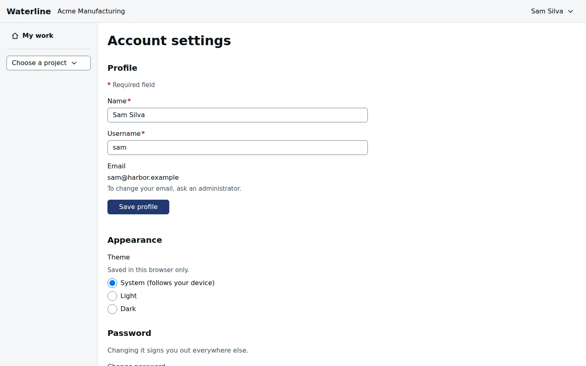

Open the menu with your name at the top right and choose **Account settings**.

## Change your profile

Change your name or username, then select **Save profile**. To change your email, ask an
administrator.

## Choose light or dark

Under **Appearance**, choose **Light** or **Dark**, or **System** to follow your device. The choice
applies at once and is remembered in this browser.

## Change your password

Select **Change password**, enter your current password and a new one, and confirm. The
requirements for a new password are listed under the field and ticked off as you type. Changing
it signs you out of every other browser.

If an administrator gave you a temporary password, you're asked to change it as soon as you sign
in.

## Sign out of other browsers

**Sessions** lists every browser you're signed in on. **Sign out other sessions** signs out all of
them except the one you're using.

> [!TIP]
> To sign out of this browser, open the menu with your name and choose **Sign out**.
