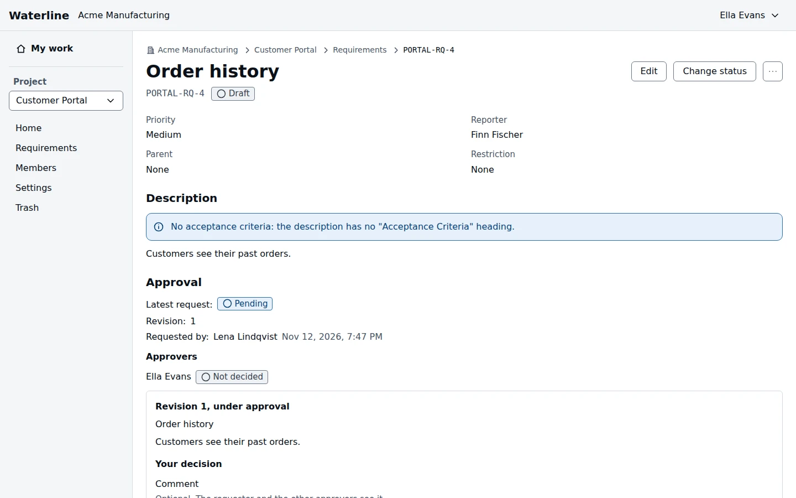

An approval records that the people who own a requirement agree with it. Each request is for one
revision of the requirement, and every approver named must approve it.

## Request approval

Project admins request approval from a requirement's **Approval** section:

1. Select **Request approval**.
2. Pick the approvers from the project's members, and add a **Note** if it helps them.
3. Select **Request approval**.

Only one request can be pending at a time. If the requirement changes while it's pending, the
approvers still decide on the revision you asked about: cancel and request again to have them
review the latest.

## Approve or reject

When you're asked to approve, the request shows on [My work](/docs/my-work), whatever your role.
Open it to see the revision under approval and, if it was approved before, what changed since.

Add a **Comment** if you like, then select **Approve** or **Reject**. Your decision is final, and the
requester and the other approvers see your comment. One rejection ends the whole request.

Once everyone has approved, the revision is recorded as approved, and a **Draft** requirement becomes
**Approved**.

## Other approval actions

| Action | Who can do this |
|---|---|
| Request approval, or re-open it on an approved requirement | Project admins |
| Cancel a pending request | Project admins |
| Approve by hand, to record a sign-off made outside Waterline | Project admins |
| Approve or reject | The approvers named |

> [!NOTE]
> If an approver loses access to the project, their place goes to the person who asked, when
> that person is still a project admin.
