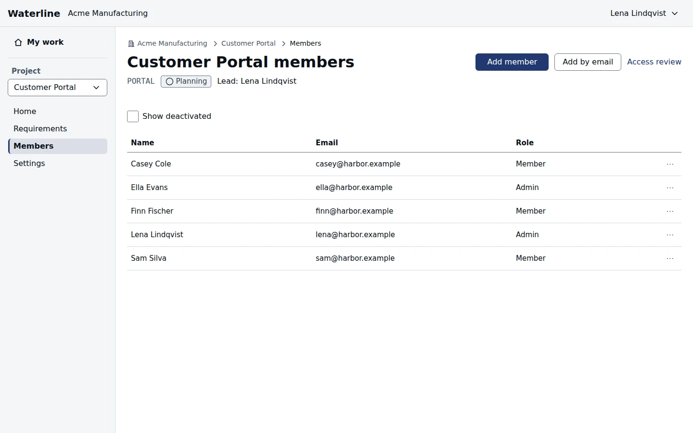

Open **Members** in the sidebar under a project to see who's on it and their roles. Anyone on the
project can see the list.

## Project roles

| Role | Can do |
|---|---|
| Viewer | Read the project and its requirements, and decide on approvals they're named in |
| Member | Everything a viewer can, plus create and edit requirements |
| Admin | Everything a member can, plus manage members, settings, and approvals |

Organization owners and admins, and workspace owners and admins, can administer every project in
their organization or workspace too.

## Add someone to a project

Project admins can add people:

- **Add member** adds someone already in the organization, or one of the workspace's staff. Start
  typing their name or email in **Person**, choose them, and give them a **Role** (**Member** to
  start).
- **Add by email** adds anyone by their email address. If they have no account yet, you create one
  with a temporary password, which they change when they first sign in.

On an export-controlled project, you're asked to confirm the person is authorized for its data.

## Change or remove someone

Each person's row offers **Change role** and **Remove from project**. A project's admins can change
anyone's role, their own included.

## See who can reach a project

**Access review** lists everyone who can open the project, and why: their project role, or an
admin role above it.
