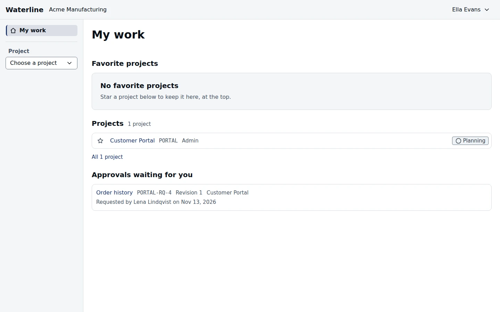

My work is the page you land on after signing in. It brings together what's yours across every
organization you belong to.

## Keep your favorite projects at hand

Select the star on a project's row to add it to **Favorite projects**, at the top of the page.
Select it again to take it off. Only you see your favorites.

## See your projects

Each organization you belong to has its own section, listing the projects you can open there,
with your role on each and its status. The projects in progress come first. Completed, cancelled,
and archived projects are tucked away; the link under the list shows them. To see every
project in an organization, follow the link at the end of its section.

## Decide on approvals

**Approvals waiting for you** lists the requirements you've been asked to approve and haven't
decided on yet, the longest-waiting first. Each shows who asked, when, and their note. Open one
to review it and give your decision; see [Approvals](/docs/approvals#approve-or-reject).

> [!TIP]
> If a section can't load, select **Try again** in it. The rest of the page still works.
