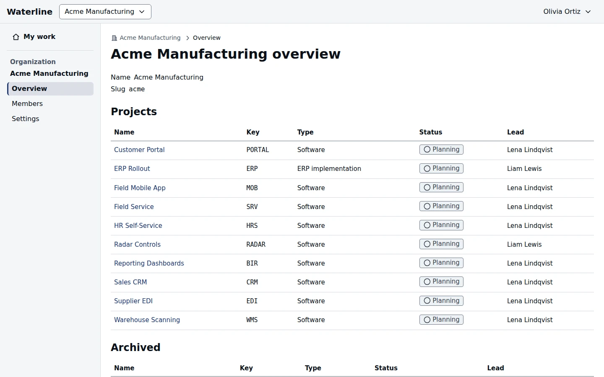

Organization owners and admins find their organization's pages in the organization menu, its name
in the header: **Overview**, **Members**, and **Settings**.

## See the organization's projects

**Overview** lists the organization's projects with their lead and status. Archived projects are
listed below. Open a project's settings from here to change it or unarchive it.

## Add and manage members

**Members** works like the workspace's staff list: **Add person** adds someone by email, and each
row offers **Change role** and **Remove from organization**. Removing someone also removes them
from the organization's projects, unless you choose otherwise.

When you add someone, the last step can also add them to some of the organization's projects:
tick each one and choose their role there. On an export-controlled project, confirm they're
authorized for its data. They join the organization and every project you chose, or none of them
if anything is refused.

## Rename the organization

**Settings** changes the organization's name and its web address. Links to its projects keep
working after the address changes.

| Action | Who can do this |
|---|---|
| See the organization's pages | Organization owners and admins |
| Grant, change, or remove the owner and admin roles | Organization owners |
| Change the name and address | Organization owners |

Workspace owners and admins can do all of this in every organization.
