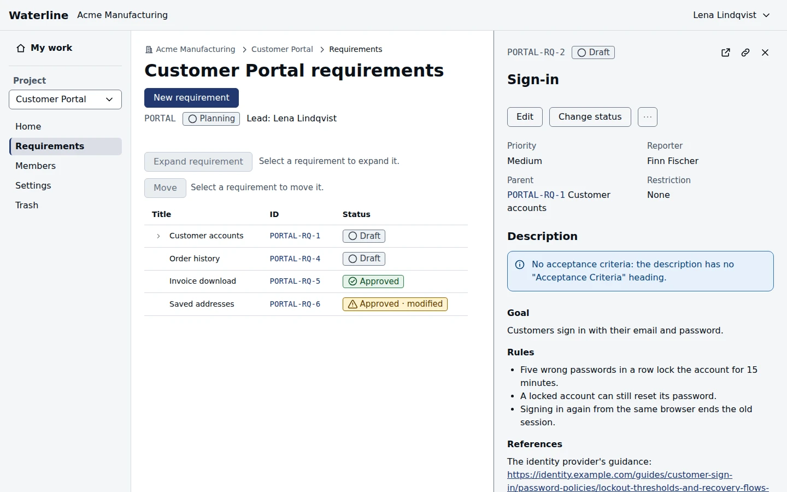

A project's requirements say what the work must do. Open **Requirements** in the sidebar under the
project to see them as a tree: each top-level requirement can hold others beneath it.

## Create a requirement

1. Select **New requirement** at the top of the page.
2. Give it a title. The description starts from your project type's template; fill in each
   heading, and write the acceptance criteria as a numbered list.
3. Choose its priority, and its parent if it belongs under another requirement.
4. Select **Create requirement**.

The description is markdown: **Preview** shows how it will read. A new requirement starts as a
draft, at the bottom of its level.

## Open a requirement

Select a requirement's ID in the tree to open it in a side panel. You can keep working in the tree
while the panel is open, and open other requirements from it. **Open full page** gives the
requirement a page of its own, and **Copy link** copies its address to share.

To open a whole branch at once, select its row and choose **Expand requirement**.

## Arrange the tree

Select a row and open its **Move** menu to move the requirement up or down among its neighbors, or
**Move to…** to give it a new parent. Its children move with it.

## Edit a requirement

Select **Edit** to change the title, description, or priority, add a change note, and select
**Save**. A changed title or description is saved as a new revision. **Change status** sets where
the requirement stands; it becomes Approved only through an [approval](/docs/approvals).

> [!WARNING]
> If someone else saved the requirement while you were editing, your save is refused. Copy what
> you typed before you reload, or it's lost.

## Follow its history

**History** lists every change, who made it, and when. **Revisions** lists the saved versions of
the title and description; **Compare revisions** shows what changed between any two.

| Action | Who can do this |
|---|---|
| Read requirements | Anyone who can see the project's content |
| Create, edit, move, change status | Project members and admins |
| Delete | Its reporter, until it's first approved, and project admins |

Deleted requirements go to the project's [Trash](/docs/trash).
