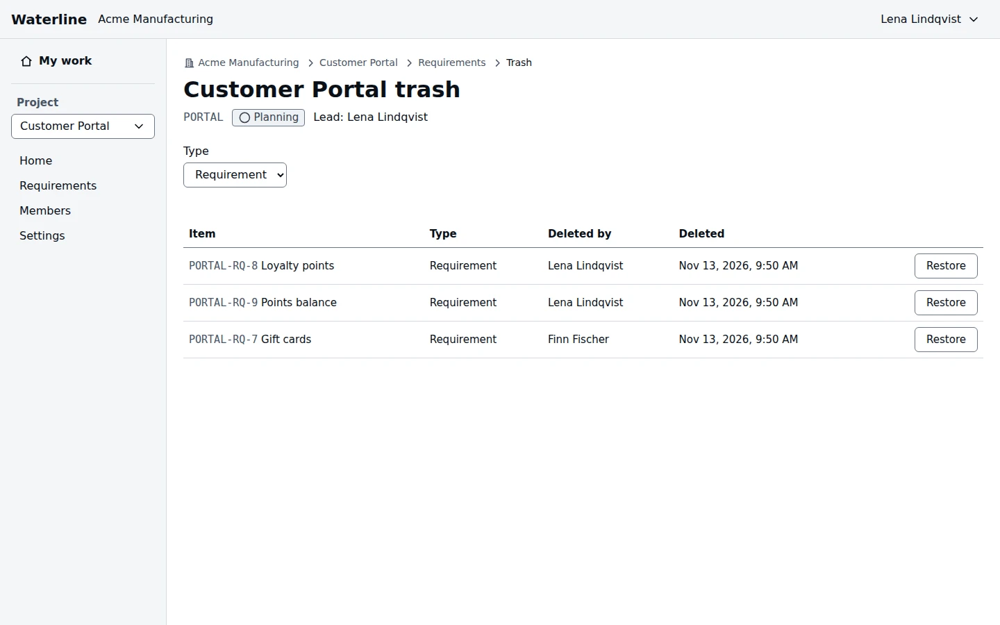

Deleting a requirement moves it to its project's Trash, where it can be restored. Nothing is
removed from the Trash automatically.

## Delete a requirement

Open the requirement, then **More actions** and **Delete…**. If it has children, choose whether
they move up to its parent or go to the Trash with it. Any pending approval request on it is
cancelled.

## Restore a requirement

On the project's **Requirements** page, select **Trash** at the top. It lists deleted
requirements; **Type** above the list filters by type. Find the requirement and select
**Restore**. The children deleted with it come back too.

| Who | Sees and restores |
|---|---|
| Project admins | Everything in the Trash |
| Members | The never-approved requirements they reported |

> [!NOTE]
> Restoring a requirement doesn't bring back an approval request that was cancelled when it was
> deleted. Request approval again if you need one.
