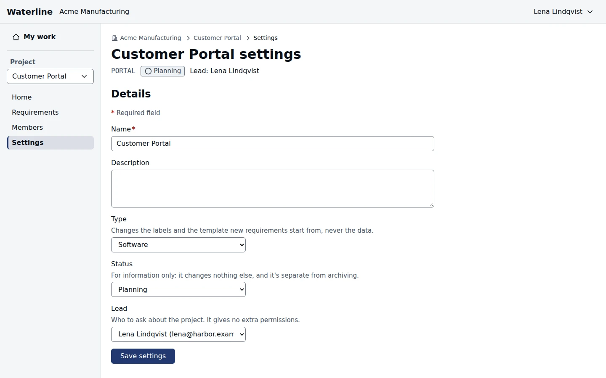

A project holds a piece of work: a software product, an ERP implementation, or anything else you
want to plan and track. Every item in it is numbered after the project's key.

## Create a project

1. Open the project selector in the sidebar and select **New project**.
2. Give the project a **Name** and a short **Key**. The key starts every item's number, and it can't be
   changed later, so pick it with care. You're told as you type if it's taken.
3. Choose its **Type**: **Software**, **ERP implementation**, or **General**. The type sets the
   labels and the template new requirements start from.
4. Set its **Restriction** if its content is sensitive.
5. Select **Create project**. The project opens, with you as its first admin and lead.

Organization owners and admins can choose **Someone else** under **First admin** instead, and
search for the person to be its first admin and lead.

## Find a project

The project selector lists the organization's projects. In a long list, select **Filter
projects** and type part of a name or key to search them all. **All projects**, below the list,
opens the organization's project list, which you can narrow by status and type.

## Change a project's settings

Open **Settings** in the sidebar under the project.

| Part | Who can do this |
|---|---|
| Details: name, description, type, status, lead | Project admins |
| Restriction | Project admins |
| Archive or unarchive the project | Organization owners and admins |

An archived project is read-only for everyone until it's unarchived.

> [!NOTE]
> Changing a project's type changes its labels, never its data.
