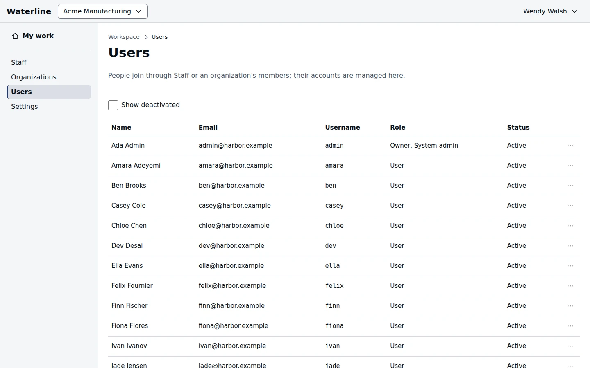

Workspace owners and admins find **Administration** in the account menu. Its pages are in the
sidebar: **Staff**, **Organizations**, **Users**, and **Settings**.

## Add staff

**Staff** lists the people who work across the workspace. Select **Add person**, enter their **Email**
and choose a **Role**. If they have no account yet, you create one with a temporary password. Copy it
and give it to them: it's shown only once.

## Create an organization

On **Organizations**, select **Create organization**, give it a **Name** and a **Slug**, its web
address, and name its **First owner**.

## Manage accounts

Each person's row has a menu with the actions your role allows you:

- **Edit details** changes their email, name, or username.
- **Reset password** gives them a new temporary password.
- **Sign out everywhere** ends all their sessions.
- **Deactivate** stops them signing in. Their work stays. **Reactivate** brings them back.
- **Access review** shows every organization and project they can reach, and why.

Lists show active people only; select **Show deactivated** to include the others.

| Action | Who can do this |
|---|---|
| See the administration pages | Workspace owners and admins |
| Change the workspace's name and address | Workspace owners |
| Act on a person's account | Anyone whose role is at the person's level or above |

> [!NOTE]
> A workspace always keeps at least one owner. To step down as the last one, you choose who
> takes over.
